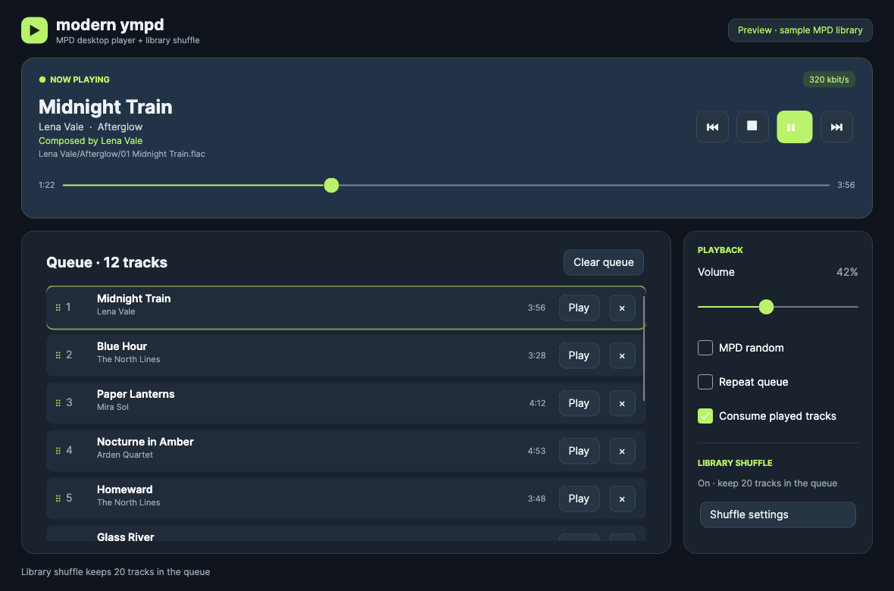
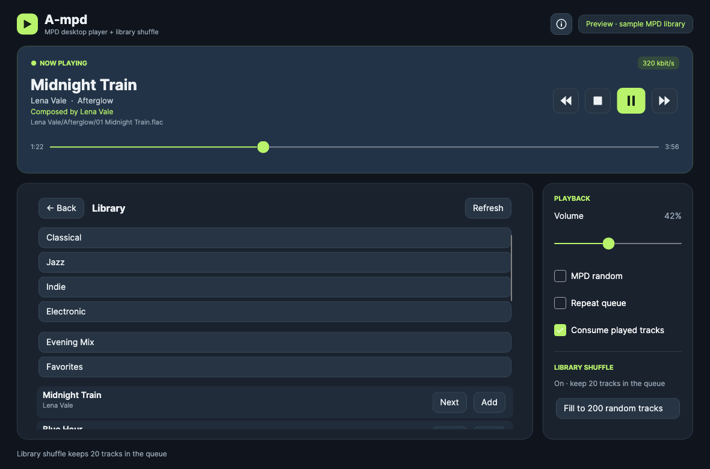
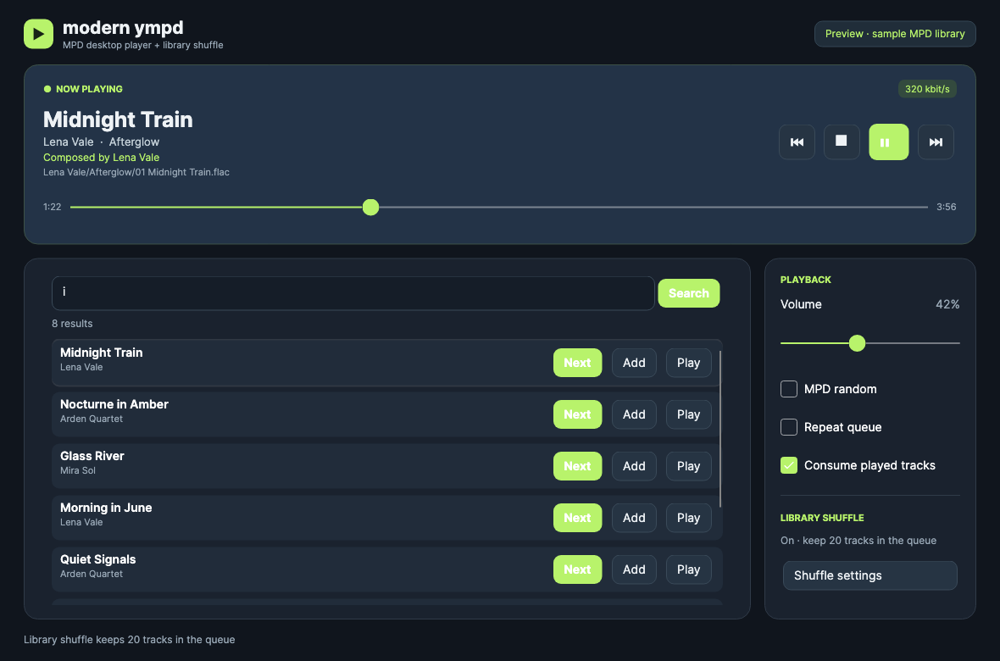
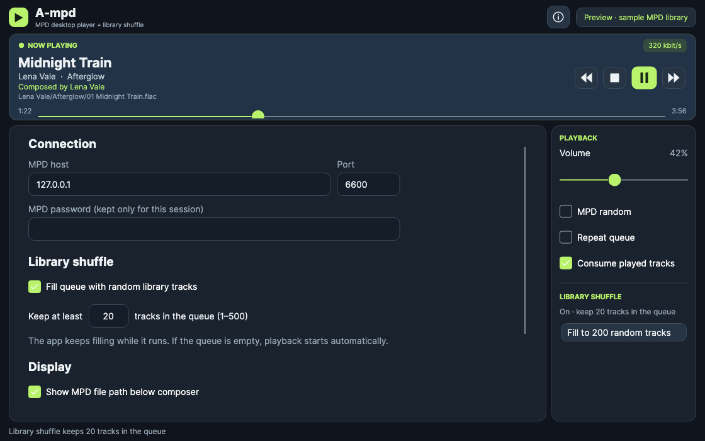
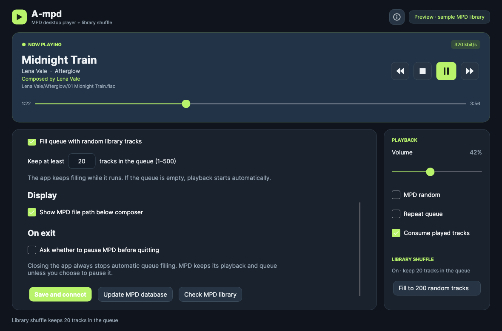
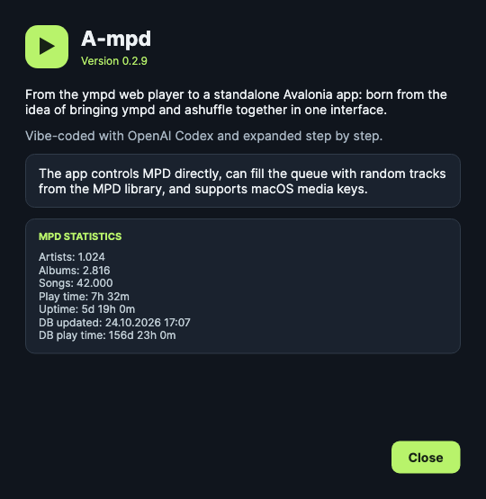
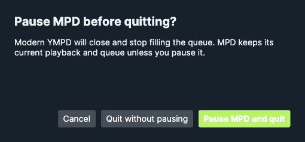

# A-mpd

An independent Avalonia desktop client for MPD. It connects directly to MPD;
the ympd web service is not required. It evolved from the ympd web player and
the idea of combining its controls with ashuffle-style queue filling.

## Features

- Queue with drag-and-drop reordering and a floating track preview, library folders,
  stored playlists, and search
- Previous, stop, play/pause, next, seek, volume, MPD random, repeat, and consume
- macOS media keys and Control Center: previous track, play/pause, next track;
  F7/F8/F9 also work while the app window is focused
- The macOS Play key can start MPD playback immediately after app launch
- An About dialog with the current version, project history, and live MPD statistics
- Composer, bitrate, and optional MPD file path in Now Playing
- Add a search or library result next, add it to the end, or play it immediately
- Keep the queue filled to a chosen size with random library songs
- Fill the queue once to 200 random library tracks with the sidebar button
- Closing the main window quits the app and stops automatic queue filling;
  Settings can enable an optional prompt to pause MPD before quitting
- On macOS, use the system menu bar's **View** menu for Queue, Library,
  Search, and Settings, and **Playback** for playback controls. The About
  dialog opens in one click from the information button in the window header
  or with Command-I.

The random filler uses MPD's `searchcount` and `search ... window` commands. It
chooses random library positions, then avoids songs already queued and the last
50 selections when possible. It has no separate music database or library cache.
It checks the queue every five seconds while the app is running. When it fills
an empty, stopped queue, it starts playback.
The 200-track button is a one-time fill and does not change the target in
Settings or start playback by itself.
The pause-on-exit prompt is off by default. Quitting leaves MPD's playback and
queue untouched unless you choose to pause in that prompt.

## Download

Prebuilt versions are listed on [GitHub Releases](https://github.com/LordMyschkin/avalonia-ympd/releases);
check the app name and version on each release. To build the current A-mpd
source, use the scripts below. They produce `dist/A-mpd-macos-arm64.dmg` and
`dist/A-mpd-win-x64.exe`, both with the .NET runtime included. The macOS app is
ad hoc signed; the Windows EXE is unsigned.

An ad hoc signature can trigger macOS Gatekeeper's unverified-app warning for
downloads. If you trust this build, launch it once, then use **System Settings →
Privacy & Security → Open Anyway**. Older builds used the same ad hoc signing.

## Screenshots

These images use a sample library with invented song metadata.

### Queue and now playing



### Library



### Search



### Settings





### About



### Optional exit prompt



## Build and run

Install the .NET 10 SDK, then run from the repository root:

```sh
dotnet restore ModernYmpd/ModernYmpd.csproj
dotnet run --project ModernYmpd/ModernYmpd.csproj
```

On macOS, build a self-contained `.app` bundle with:

```sh
./build-macos-app.sh
open "dist/A-mpd.app"
```

The macOS media-key bridge is compiled into this `.app` by the build script.
The plain `dotnet run` command does not include that native bridge.

On macOS, `./build-macos-dmg.sh` packages this app in a DMG.

To cross-build the self-contained Windows x64 EXE from macOS or Linux, run
`./build-windows-exe.sh`. The result is `dist/A-mpd-win-x64.exe`.

To regenerate the sample screenshots, run
`dotnet run --project ModernYmpd/ModernYmpd.csproj -- --render-screenshots docs/screenshots`.

The bundle contains its .NET runtime. It is built for the Mac's current CPU
architecture, includes the app icon, and can be moved to `Applications`. The
build output under `dist` is ignored by Git.

The default MPD address is `127.0.0.1:6600`. Connection and shuffle settings
are saved in the user's application-data folder under
`modern-ympd/settings.json`. The MPD password is held only until the app quits.
Unhandled .NET errors are written to `modern-ympd/errors.log` in the same folder.
If the original ympd service is also set to fill the queue, disable that setting
there to avoid two independent fillers.

For a read-only connection check, run:

```sh
dotnet run --project ModernYmpd/ModernYmpd.csproj -- --check-mpd Bach
```

This project is based on the interface and playback workflow of
[modern-ympd](https://github.com/LordMyschkin/modern-ympd). It is licensed under
GPLv2; see [LICENSE](LICENSE).
